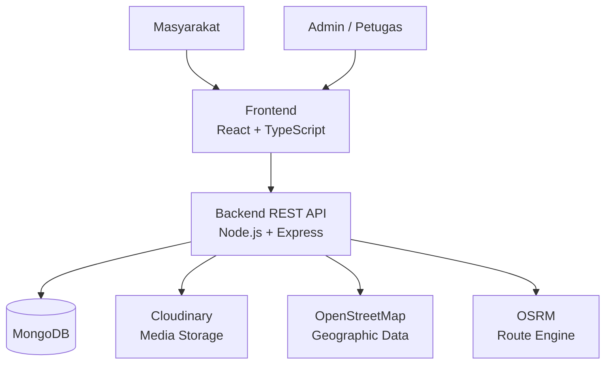
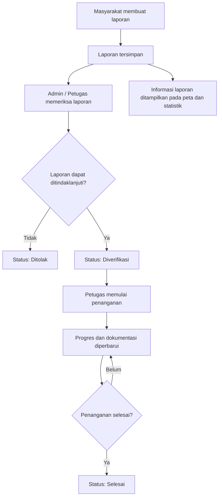

<div align="center">

# PantauJalan

### Bersama Mewujudkan Infrastruktur Publik yang Lebih Baik

Platform digital untuk melaporkan kerusakan fasilitas umum, memantau proses penanganannya, dan membantu masyarakat menemukan rute dengan mempertimbangkan kondisi jalan.

</div>

---

## Tentang PantauJalan

**PantauJalan** adalah platform yang menghubungkan masyarakat dengan proses penanganan kerusakan fasilitas umum. Melalui platform ini, masyarakat dapat menyampaikan laporan kerusakan, melengkapi laporan dengan foto dan lokasi, serta memantau perkembangan penanganannya secara transparan.

PantauJalan juga menyediakan informasi statistik laporan dan fitur navigasi yang mempertimbangkan titik kerusakan jalan. Dengan begitu, informasi yang dikumpulkan dari laporan masyarakat tidak hanya menjadi dokumentasi, tetapi juga dapat menjadi informasi pendukung ketika pengguna merencanakan perjalanan.

Project ini dikembangkan dengan pendekatan **full-stack web application**, yang terdiri dari frontend untuk masyarakat dan petugas serta backend sebagai REST API.

## Fitur Utama

### 1. Pelaporan Kerusakan Fasilitas Umum

Masyarakat dapat membuat laporan kerusakan fasilitas umum dengan menyertakan:

- Judul dan deskripsi kerusakan.
- Kategori fasilitas yang mengalami kerusakan.
- Tingkat keparahan kerusakan.
- Foto sebagai dokumentasi.
- Lokasi kerusakan berdasarkan koordinat.

Kategori laporan yang tersedia:

| Kategori | Keterangan |
|---|---|
| Jalan | Kerusakan pada badan atau permukaan jalan. |
| Lampu jalan | Lampu penerangan jalan yang rusak atau tidak berfungsi. |
| Trotoar | Kerusakan pada jalur pedestrian. |
| Halte | Kerusakan fasilitas halte. |
| Taman | Kerusakan fasilitas taman publik. |
| Lainnya | Kerusakan fasilitas umum di luar kategori yang tersedia. |

### 2. Pemantauan Progres Penanganan

Masyarakat dapat melihat detail laporan dan mengikuti perkembangan penanganannya melalui timeline progres.

Petugas dapat menambahkan dokumentasi pada setiap tahap penanganan, termasuk foto dan informasi biaya penanganan. Informasi progres ditampilkan pada halaman detail laporan agar masyarakat dapat mengetahui perkembangan tindak lanjut.

Status laporan:

`menunggu` → `diverifikasi` → `diproses` → `selesai`

Laporan juga dapat memiliki status `ditolak` apabila tidak dapat ditindaklanjuti.

### 3. Statistik Laporan Publik

PantauJalan menyediakan ringkasan dan visualisasi data laporan untuk membantu masyarakat memahami kondisi fasilitas umum yang dilaporkan.

Informasi statistik dapat dikelompokkan berdasarkan beberapa dimensi, seperti:

- Status laporan.
- Kategori kerusakan.
- Tingkat keparahan.
- Wilayah atau lokasi laporan.

### 4. Navigasi dengan Mempertimbangkan Kerusakan Jalan

Fitur navigasi menampilkan peta, pilihan lokasi awal dan tujuan, serta titik kerusakan yang berasal dari laporan.

Pengguna dapat memilih jenis perjalanan:

- Mobil.
- Motor.
- Jalan kaki.

Backend memproses permintaan rute dengan memanfaatkan layanan OSRM dan data laporan kerusakan untuk mencari alternatif rute sesuai aturan yang diterapkan. Titik kerusakan ditampilkan pada peta agar pengguna memperoleh informasi tambahan sebelum atau selama merencanakan perjalanan.

> Ketersediaan dan akurasi rute alternatif bergantung pada data OpenStreetMap, layanan routing, serta kelengkapan dan kebaruan laporan kerusakan. Informasi ini bukan jaminan bahwa seluruh kondisi jalan telah terpetakan.

### 5. Dashboard Admin dan Petugas

Area admin/petugas menyediakan fitur untuk:

- Melihat ringkasan laporan pada dashboard.
- Menelusuri dan memfilter laporan.
- Melihat detail laporan masyarakat.
- Mengelola tindak lanjut dan status laporan.
- Menambahkan serta memperbarui progres perbaikan.
- Mengunggah dokumentasi proses penanganan.
- Mengelola pengguna sesuai hak akses.

### 6. Dukungan Multibahasa

Antarmuka menyediakan pilihan bahasa:

- Bahasa Indonesia.
- English.
- Cakap Medan.

---

## Teknologi yang Digunakan

### Frontend

| Teknologi | Penggunaan |
|---|---|
| [React](https://react.dev/) | Library antarmuka pengguna. |
| [TypeScript](https://www.typescriptlang.org/) | Static typing pada frontend. |
| [Vite](https://vite.dev/) | Development server dan build tool. |
| [Tailwind CSS](https://tailwindcss.com/) | Styling antarmuka. |
| [React Router](https://reactrouter.com/) | Routing halaman. |
| [Axios](https://axios-http.com/) | Komunikasi HTTP dengan backend. |
| [Leaflet](https://leafletjs.com/) & [React Leaflet](https://react-leaflet.js.org/) | Peta interaktif. |
| [OpenStreetMap](https://www.openstreetmap.org/) | Data peta. |
| [i18next](https://www.i18next.com/) | Internasionalisasi dan pengelolaan bahasa. |
| [Framer Motion](https://motion.dev/) | Animasi antarmuka. |
| [Lucide](https://lucide.dev/) | Ikon antarmuka. |
| [SweetAlert2](https://sweetalert2.github.io/) | Notifikasi dan dialog interaktif. |

### Backend

| Teknologi | Penggunaan |
|---|---|
| [Node.js](https://nodejs.org/) | Runtime JavaScript. |
| [Express](https://expressjs.com/) | REST API. |
| [MongoDB](https://www.mongodb.com/) | Database. |
| [Mongoose](https://mongoosejs.com/) | ODM untuk MongoDB. |
| [JSON Web Token](https://jwt.io/) | Autentikasi berbasis token. |
| [bcryptjs](https://www.npmjs.com/package/bcryptjs) | Hash password. |
| [Multer](https://www.npmjs.com/package/multer) | Middleware upload file. |
| [Cloudinary](https://cloudinary.com/) | Penyimpanan dan pengelolaan media. |
| [OSRM](https://project-osrm.org/) | Perhitungan rute. |
| [OpenStreetMap](https://www.openstreetmap.org/) | Sumber data geografis. |

---

## Arsitektur Project

PantauJalan menggunakan arsitektur frontend dan backend yang terpisah. Frontend berkomunikasi dengan backend melalui REST API.



### Alur Utama Aplikasi



## Struktur Repository

```text
PantauJalan/
├── backend/
│   ├── src/
│   │   ├── config/          # Konfigurasi database dan Cloudinary
│   │   ├── controllers/     # Handler endpoint API
│   │   ├── middlewares/     # Auth, upload, dan error handling
│   │   ├── models/          # Model User, Report, RepairProgress
│   │   ├── routes/          # Definisi route API
│   │   ├── seeds/           # Seed akun admin
│   │   ├── services/        # Geocoding dan routing
│   │   ├── utils/           # Helper dan utilitas
│   │   ├── app.js
│   │   └── server.js
│   ├── .env.example
│   ├── package.json
│   └── README.md
│
├── frontend/
│   ├── public/              # Aset statis
│   ├── src/
│   │   ├── components/      # Komponen bersama
│   │   ├── config/          # Konfigurasi API
│   │   ├── i18n/            # Konfigurasi dan file bahasa
│   │   ├── layouts/         # Layout aplikasi
│   │   ├── pages/
│   │   │   ├── admin/       # Halaman admin/petugas
│   │   │   └── client/      # Halaman masyarakat
│   │   ├── utils/
│   │   ├── App.tsx
│   │   └── main.tsx
│   ├── .env.example
│   ├── package.json
│   └── README.md
│
└── README.md
```

---

## Menjalankan Project Secara Lokal

### Persyaratan

Pastikan perangkat sudah memiliki:

- Node.js 18 atau lebih baru.
- npm.
- MongoDB lokal atau MongoDB Atlas.
- Akun Cloudinary untuk penyimpanan media.
- Koneksi internet untuk layanan peta dan routing.

### 1. Clone Repository

```bash
git clone <URL_REPOSITORY>
cd PantauJalan
```

Ganti `<URL_REPOSITORY>` dengan URL repository GitHub project.

### 2. Menjalankan Backend

Masuk ke folder backend:

```bash
cd backend
npm install
```

Salin file environment:

```bash
cp .env.example .env
```

Sesuaikan konfigurasi pada `.env`, terutama:

```env
PORT=5000
MONGO_URI=mongodb://127.0.0.1:27017/pantaujalan
BASE_URL=http://localhost:5000

JWT_SECRET=your_strong_secret
JWT_EXPIRES_IN=7d

ADMIN_NAME=Administrator
ADMIN_EMAIL=admin@pantaujalan.local
ADMIN_PASSWORD=change_this_password

CLOUDINARY_CLOUD_NAME=your_cloud_name
CLOUDINARY_API_KEY=your_api_key
CLOUDINARY_API_SECRET=your_api_secret
```

Buat akun admin awal:

```bash
npm run seed:admin
```

Jalankan backend dalam mode development:

```bash
npm run dev
```

Backend secara default berjalan di:

```text
http://localhost:5000
```

### 3. Menjalankan Frontend

Buka terminal baru, kemudian:

```bash
cd frontend
npm install
```

Salin file environment:

```bash
cp .env.example .env
```

Atur URL backend:

```env
VITE_API_BASE_URL=http://localhost:5000
```

Jalankan frontend:

```bash
npm run dev
```

Frontend secara default dapat diakses melalui:

```text
http://localhost:5173
```

---

## Environment Variables

### Backend

Konfigurasi lengkap tersedia pada `backend/.env.example`.

| Variabel | Keterangan |
|---|---|
| `PORT` | Port server backend. |
| `MONGO_URI` | Connection string MongoDB. |
| `BASE_URL` | Base URL backend. |
| `JWT_SECRET` | Secret untuk JWT. |
| `JWT_EXPIRES_IN` | Masa berlaku token. |
| `ADMIN_NAME` | Nama admin awal untuk seed. |
| `ADMIN_EMAIL` | Email admin awal untuk seed. |
| `ADMIN_PASSWORD` | Password admin awal untuk seed. |
| `CLOUDINARY_CLOUD_NAME` | Cloud name Cloudinary. |
| `CLOUDINARY_API_KEY` | API key Cloudinary. |
| `CLOUDINARY_API_SECRET` | API secret Cloudinary. |
| `OSRM_URL` | URL layanan OSRM utama. |
| `OSRM_PROFILE` | Profil routing utama. |
| `OSRM_FOOT_URL` | URL layanan OSRM untuk pejalan kaki. |
| `OSRM_FOOT_PROFILE` | Profil routing pejalan kaki. |
| `OSRM_TIMEOUT_MS` | Timeout request OSRM. |
| `ROUTING_*` | Pengaturan penghindaran hazard dan alternatif rute. |

### Frontend

| Variabel | Keterangan |
|---|---|
| `VITE_API_BASE_URL` | URL dasar REST API backend. |

> Jangan mengunggah file `.env` ke repository publik. Variabel `VITE_` akan masuk ke bundle frontend, sehingga hanya gunakan untuk konfigurasi yang memang aman diketahui browser.

---

## Ringkasan Endpoint API

Base URL lokal:

```text
http://localhost:5000
```

| Modul | Prefix | Fungsi |
|---|---|---|
| Authentication | `/api/auth` | Registrasi, login, dan profil pengguna. |
| Users | `/api/users` | Pengelolaan akun dan role pengguna. |
| Reports | `/api/reports` | Pengaduan, detail laporan, dan statistik. |
| Progress | `/api/reports/:reportId/progress` dan `/api/progress` | Dokumentasi serta timeline penanganan. |
| Routes | `/api/routes` | Data titik kerusakan dan perhitungan rute aman. |

Untuk detail endpoint, request body, response, serta cara menjalankan masing-masing aplikasi, lihat dokumentasi:

- [Backend README](./backend/README.md)
- [Frontend README](./frontend/README.md)

---

## Role Pengguna

| Role | Deskripsi |
|---|---|
| `masyarakat` | Membuat laporan dan memantau informasi penanganan. |
| `petugas` | Memeriksa laporan dan memperbarui progres penanganan. |
| `admin` | Mengelola pengguna serta memiliki akses pengelolaan laporan dan penanganan. |

Hak akses tetap diperiksa oleh backend melalui middleware autentikasi dan otorisasi.

## Catatan Pengembangan

- Data laporan dan progres disimpan pada MongoDB.
- Gambar laporan dan dokumentasi progres dikelola melalui Cloudinary.
- Peta interaktif menggunakan Leaflet dengan tile/data OpenStreetMap.
- Perhitungan rute dilakukan melalui backend menggunakan OSRM.
- Rute alternatif mempertimbangkan laporan kerusakan berdasarkan aturan konfigurasi routing.
- Akurasi informasi kondisi jalan bergantung pada kualitas data laporan dan data peta yang tersedia.

## Kontribusi

Kontribusi untuk pengembangan PantauJalan terbuka. Untuk berkontribusi:

1. Fork repository.
2. Buat branch fitur atau perbaikan:

   ```bash
   git checkout -b feature/nama-fitur
   ```

3. Lakukan perubahan dan pengujian.
4. Commit perubahan dengan pesan yang jelas:

   ```bash
   git commit -m "feat: add report filtering"
   ```

5. Push branch dan buat Pull Request.

## Lisensi

Project **PantauJalan** dikembangkan oleh **Team Apa Aja Selain Skripsi**.

Hak cipta atas kode sumber dan aset project tetap berada pada tim pengembang. Penggunaan, penyalinan, modifikasi, maupun pendistribusian project ini untuk keperluan di luar kontribusi tim memerlukan izin dari Team Apa Aja Selain Skripsi.
